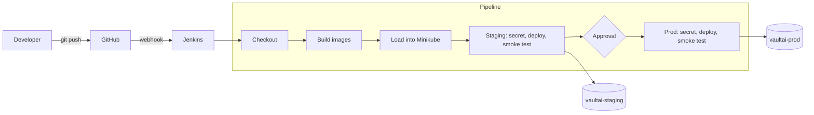

# VaultAI CI/CD Pipeline (Git, Jenkins, Kubernetes)

This repo has a Jenkins pipeline that builds and deploys the VaultAI app whenever code is pushed to GitHub. A push to `main` builds the API and web images, deploys them to a staging namespace on Kubernetes, runs a quick health check, and then waits for someone to approve the release. If it is approved, the same images go to production. Nothing is rebuilt for prod.

I built and tested all of this on a local Minikube cluster, so a few things (the webhook tunnel, loading images straight into Minikube) are local-dev workarounds. I've listed them in the security section so it's clear what I would change in a real setup.

## How it fits together


The same flow as a diagram that GitHub renders from text:



Staging and prod are not separate branches. There is one `main` branch, and the differences between environments (namespace, replica count, resource limits) live in Kustomize overlays. I went this way so that what gets tested in staging is exactly what gets shipped, and so adding an environment means adding a folder instead of copying the pipeline.

## What's in the repo

```
Jenkinsfile              the pipeline (Declarative, with Groovy helper functions)
api/Dockerfile           API image (Python)
app/Dockerfile           web image (Node build, served by nginx)
nginx/default.conf       nginx config, including the API proxy
k8s/base/                shared Deployments and Services
k8s/overlays/staging/    namespace vaultai-staging, 2 replicas
k8s/overlays/prod/       namespace vaultai-prod, 3 replicas, higher API limits
jenkins/Dockerfile       Jenkins image with the docker CLI and kubectl added
```

## What you need

- Docker, kubectl and a running Minikube cluster
- A GitHub repo with this code, plus a personal access token that can read it
- Node.js and npm on the host, only for the webhook forwarder

## Setup

### 1. Kubernetes

```bash
kubectl create namespace vaultai-staging
kubectl create namespace vaultai-prod

# check that both overlays render before applying anything
kubectl kustomize k8s/overlays/staging
kubectl kustomize k8s/overlays/prod
```

### 2. Jenkins

The pipeline needs `docker` and `kubectl` inside the Jenkins container, which the stock image doesn't have. `jenkins/Dockerfile` adds them.

```bash
docker build -t jenkins-custom:latest jenkins/

docker run -d --name jenkins --restart unless-stopped --network minikube \
  -p 8090:8080 \
  -v jenkins_home:/var/jenkins_home \
  -v /var/run/docker.sock:/var/run/docker.sock \
  -v $HOME/.minikube:$HOME/.minikube \
  -v $HOME/.kube:/root/.kube \
  -e MINIKUBE_HOME=$HOME/.minikube \
  -e JAVA_OPTS="-Xmx512m -Xms256m -Dhudson.plugins.git.GitStatus.NOTIFY_COMMIT_ACCESS_CONTROL=disabled-for-polling" \
  jenkins-custom:latest
```

Plugins I used: Git, Pipeline, Multibranch Pipeline, Credentials Binding, Timestamper, Workspace Cleanup, and Blue Ocean for the nicer stage view.

The `JAVA_OPTS` flag is explained in the webhook section below.

### 3. Credentials

Add these under Manage Jenkins, Credentials:

| ID | Type | Used for |
|---|---|---|
| `github-token` | Username and password (PAT) | reading the repo |
| `minikube-kubeconfig` | Secret file | kubectl access to the cluster |
| `vaultai-anthropic-key` | Secret text | the app's API key, which the pipeline puts into a Kubernetes Secret |

None of these are in the repo or in the build logs. Jenkins masks them when they are used.

### 4. The Jenkins job

Create a Multibranch Pipeline job, point it at the GitHub repo with the `github-token` credential, and leave the script path as `Jenkinsfile`. Every branch gets built, but only `main` deploys. That branch name is set in `appConfig()` at the top of the Jenkinsfile.

### 5. Triggering builds on push

Jenkins runs on localhost, so GitHub can't call it directly. I used [smee.io](https://smee.io), which is a common way to get around this in local development.

1. Create a channel on smee.io, then add a webhook in the GitHub repo settings. Use the smee URL as the payload URL, `application/json` as the content type, and send only push events.
2. Run the forwarder as a systemd service so it keeps going after the terminal is closed:

```bash
sudo tee /etc/systemd/system/smee-jenkins.service > /dev/null << 'EOF'
[Unit]
Description=smee.io webhook forwarder for Jenkins
After=network.target docker.service

[Service]
Type=simple
ExecStart=/usr/bin/npx --yes smee-client --url https://smee.io/<your-channel> --target http://localhost:8090/git/notifyCommit?url=https://github.com/kernal05/Finacplus-Vaultai
Restart=always
RestartSec=5
User=vishal

[Install]
WantedBy=multi-user.target
EOF

sudo systemctl daemon-reload
sudo systemctl enable --now smee-jenkins
```

3. By default the Git plugin answers `401 An access token is required` to calls like this. The Jenkins version I used didn't show a place to create a notifyCommit token, so I set `NOTIFY_COMMIT_ACCESS_CONTROL=disabled-for-polling` in `JAVA_OPTS` instead. All that does is let the endpoint ask Jenkins to rescan the repo. It can't run anything else.

The job also scans the repo every minute, so if the webhook path is down (for example the laptop was asleep), the push is still picked up a little later.

On a real server with a public address, GitHub would call Jenkins directly and none of the smee setup would be needed.

## What the pipeline does

1. **Checkout.** Gets the commit and builds an image tag like `build-16-1f682e4` (build number plus short commit), so any running pod can be traced back to a commit.
2. **Build images.** Builds the API and web images.
3. **Load images into Minikube.** Copies the images into the cluster node. This stands in for pushing to a registry and takes about three minutes, which is the slowest part of the pipeline.
4. **Sync staging secret.** Creates or updates the Kubernetes Secret before the deploy, so new pods start with the current value.
5. **Deploy staging.** Applies the staging overlay, sets the new images and waits for the rollout. If the rollout doesn't finish in 180 seconds, it runs `kubectl rollout undo` on every component and fails the build.
6. **Staging smoke test.** Runs the health endpoints from inside the API and web pods.
7. **Approve production.** Waits up to 30 minutes for a person to choose. The default option is "Skip production (staging only)". This step doesn't hold a Jenkins executor while it waits.
8. **Production stages.** Same secret, deploy and smoke test steps against the prod overlay, using the image that was already tested in staging.

If a new push arrives while a build is sitting at the approval step, the old build is aborted and replaced (`abortPrevious`). Without that, a forgotten approval would block every later build.

## Using it for other repos or clusters

The repo-specific parts are in two functions at the top of the Jenkinsfile.

`appConfig()` lists the components to build and deploy: deployment name, container, image name, Dockerfile, build context and smoke test command. It also holds the secret name and which branch deploys. To onboard another service, add another entry to the list.

`envConfig()` lists the environments: namespace, overlay folder, and the Jenkins credential IDs for the kubeconfig and the API key. To add an environment or point at a different cluster, add an entry, create a credential, and add a `k8s/overlays/<name>` folder.

If this were used across many repos, I would move the helper functions into a Jenkins Shared Library and keep only these two config functions in each repo's Jenkinsfile. I haven't done that here.

## Security notes

What is already in place:

- No credentials in the code or the git history. `git grep "sk-ant"` and `git log -S"sk-ant"` both return nothing.
- Secrets reach the pipeline through Jenkins credentials and are masked in logs.
- Production needs a manual approval, and `PROD_APPROVERS` in the Jenkinsfile can restrict who can give it. It is empty at the moment, so anyone who can run the build can approve. It should be set to real user IDs before this is used for anything real.
- Only `main` deploys. Other branches stop after building images.
- The API container runs as a non-root user. All containers have resource limits and liveness and readiness probes.

Shortcuts I took because this runs locally, and what I'd do instead:

| Shortcut | What I'd do in a real setup |
|---|---|
| Staging and prod use the same kubeconfig and API key credential | Separate credentials per environment, with RBAC limited to that namespace. In the Jenkinsfile this is only a change of two credential IDs in `envConfig()`. |
| Webhook endpoint is open to unauthenticated calls (rescan only) | Public HTTPS Jenkins with a notifyCommit token or a signed GitHub webhook |
| Images are loaded straight into Minikube | Push to a private registry with fixed tags, and scan images (for example with Trivy) before deploying |
| Docker socket is mounted into Jenkins | Throwaway build agents such as Kubernetes agents or Kaniko |

## How I tested it

- **Manifests:** `kubectl kustomize k8s/overlays/staging` and `.../prod` show the right namespace, replica count and limits.
- **Webhook:** pushed a commit and watched `journalctl -u smee-jenkins -f`. It showed `POST ... - 200` and a build started right away.
- **Smoke tests:** the API returns `{"status":"ok","service":"vaultai-api"}` and the web pod returns `ok`, in both environments.
- **Full promotion (build 16):** staging, approval, then the same image tag in prod with 3 replicas each.
- **Rollback (build 17):** I changed the API readiness probe path from `/healthz` to `/nope` and pushed. The new pod never became ready, the rollout hit the 180 second timeout, the pipeline ran the rollback and failed with "rolled back automatically", and production was never reached. Old pods kept serving the whole time.
- **Recovery (build 18):** reverted the change, and the next build went through normally.

To repeat the rollback test, break the probe path in `k8s/base/api-deployment.yaml`, push, and revert once the build has failed. Wait for the failed build to finish before pushing the revert, because a new push aborts a running build.

## Monitoring and logging

Prometheus and Grafana run **inside the cluster**, in their own `monitoring` namespace. The full
`kube-prometheus-stack` Helm chart did not fit on this machine (Windows has 7 GB of RAM, WSL gets
4.8 GB, Minikube started with 2.1 GB), so I run two plain Deployments instead. Together they are
limited to about 580 MiB.

| What | How |
|------|-----|
| Prometheus | Scrapes every `vaultai-api` pod in `vaultai-staging` and `vaultai-prod` (found through the Kubernetes API, so new replicas are picked up automatically) and Jenkins (`/prometheus/`, from the Prometheus Metrics plugin). 30s interval, 6h retention. |
| Grafana | One provisioned dashboard, "VaultAI - App and CI/CD pipeline": scrape targets up/down, Jenkins up, builds recorded, average build duration, API requests per second by status, API p95 latency, API 5xx ratio. |
| Alert rules | `VaultAIAPIDown`, `VaultAIHighErrorRate` (>5% 5xx), `VaultAIHighLatency` (p95 > 3s), `JenkinsDown`. |
| Install | `bash monitoring/monitoring-lite.sh` (idempotent; `--remove` deletes everything). |
| Access | Nothing is exposed outside the cluster. `monitoring/monitoring-portforward-service.sh` keeps `localhost:3000` (Grafana) and `localhost:9090` (Prometheus) available as systemd services. |

**Security of the monitoring stack.** The namespace enforces the Pod Security `restricted` profile.
Containers run as non-root with all capabilities dropped and a read-only root filesystem (Prometheus).
Prometheus's service account can only read pod metadata. The Grafana admin password is random and
stored in a Kubernetes Secret.

**What I checked.** All 7 Prometheus targets were UP (Jenkins, Prometheus itself, 2 staging API pods
and 3 prod API pods), and the Grafana dashboard loaded data from them.

**Limits, stated plainly.**
- There is no Alertmanager. The alert rules show as pending or firing on Prometheus's Alerts page, but
  nothing is sent anywhere. I did not trigger an alert on purpose.
- Metrics and dashboards live in temporary (emptyDir) volumes with 6 hours of retention, so history is lost when a pod restarts. The dashboard itself is provisioned from a ConfigMap and comes back.
- No kube-state-metrics or node metrics, so there are no pod-restart or CPU/memory panels.
- Logs are not collected centrally. `kubectl logs deploy/<name> -n <namespace>` is the current answer.

**What I would add next.**
- Alertmanager with a Slack receiver, and a build-failure alert from Jenkins metrics.
- kube-state-metrics for unavailable replicas, crash loops and failed rollouts.
- Loki (or EFK) for container logs.
- A registry push instead of the Minikube image load, which would remove about 2 to 3 minutes per build.
- The approval step already records who approved a release in the build log.

## Troubleshooting

- **Webhook returns 401.** The Git plugin wants a notifyCommit token. Either create one or use the `JAVA_OPTS` flag from step 2.
- **"No git jobs using repository" in the webhook response.** Normal for a multibranch job. It still schedules a branch scan.
- **Rollout times out.** Look at `kubectl describe pod` and check the probe paths. The pipeline will already have rolled back.
- **`ErrImagePull` in a pod.** The image wasn't loaded into Minikube. Check the "Load Images into Minikube" stage.
- **A running build disappears after a new push.** That's the `abortPrevious` setting doing its job.
- **Rollouts or health checks time out on a small machine.** This happened here: Minikube was capped at
  2.1 GB and ran at 80 to 90 percent of it, probes timed out after 1 second, pods restarted and a rollout
  hung for 30 minutes. Fixes: raise the container's memory cap (`monitoring/stabilize.sh` sets 3 GB without
  recreating the cluster; the cap resets when Minikube or WSL restarts, so run it again after a restart),
  and use probe timeouts of 5 seconds instead of the default 1 second. The deploy stage also wraps
  `kubectl rollout status` in `timeout 240` so a stalled machine fails the build (and rolls back) in
  minutes instead of hanging it.
