# VaultAI CI/CD Pipeline (Git, Jenkins, Kubernetes)

This repo has a Jenkins pipeline that builds and deploys the VaultAI app whenever code is pushed to GitHub. A push to `main` builds the API and web images, deploys them to a staging namespace on Kubernetes, runs a quick health check, and then waits for someone to approve the release. If it is approved, the same images go to production. Nothing is rebuilt for prod.

I built and tested all of this on a local Minikube cluster, so a few things (the webhook tunnel, loading images straight into Minikube) are local-dev workarounds. I've listed them in the security section so it's clear what I would change in a real setup.

## At a glance

| | |
|---|---|
| **What it is** | A push-to-deploy CI/CD pipeline: GitHub, Jenkins (Groovy), Kubernetes, with monitoring and alerting |
| **What happens on a push** | Lint, build, scan, deploy to staging, smoke test, one approval, the same image goes to production |
| **If something breaks** | The rollout is undone automatically and prod is never touched. An alert email arrives if the app goes down |
| **Result** | A full run takes about 14 to 17 minutes here, down from 25 to 30. Moving to a registry should bring it to roughly 10 to 14 (estimate) |
| **Effort** | About 5 to 7 hours to get the infrastructure running. The rest of the time went into debugging, hardening and documentation |
| **Live app** | [http://103.192.198.240:7101](http://103.192.198.240:7101), see [Live application](#live-application) |
| **Runs on** | One laptop (Minikube), no cloud spend. The cloud path is documented as a plan |

## Live application

The application this case study delivers is running here: **[http://103.192.198.240:7101](http://103.192.198.240:7101)**

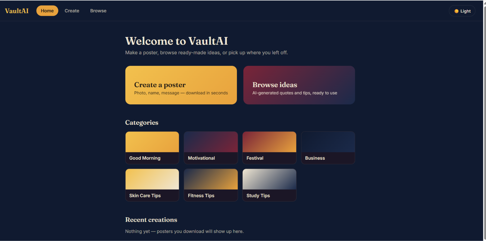

This copy is hosted on a server and deployed separately (Docker Compose), not by the Jenkins pipeline in this repository. The same application is what the pipeline builds and ships to the staging and prod namespaces on Kubernetes. I'm linking it so reviewers can see the product itself, not just the delivery pipeline.

It is a demo: plain HTTP on an IP address. For real users I would put it behind HTTPS and a domain name, and rate-limit the endpoints that call the AI model.

## The assignment, and where each part is answered

This is my submission for the CI/CD case study: Git + Jenkins + Kubernetes, automated with Groovy.

| Requirement | How it is met | Where to look |
|---|---|---|
| A commit to a Git repo triggers a Jenkins build | GitHub push webhook (relayed by smee.io because Jenkins runs on localhost) starts a Multibranch Pipeline | [Triggering builds on push](#5-triggering-builds-on-push) |
| A successful build is deployed to a Kubernetes cluster | Images are built, scanned, deployed to staging, smoke-tested, then promoted to prod after one approval | [What the pipeline does](#what-the-pipeline-does) |
| Scalable and adaptable to other repos and clusters | Two config functions in the Jenkinsfile (`appConfig()`, `envConfig()`) plus a Kustomize overlay per environment. No pipeline code changes | [Using it for other repos or clusters](#using-it-for-other-repos-or-clusters) |
| Groovy automation logic | `Jenkinsfile`: Declarative pipeline with Groovy helper functions (`deployEnv`, `smokeTest`, `rollbackEnv`, `syncSecret`, `scanImages` and others) | `Jenkinsfile` |
| Less manual work, consistent releases | One image per commit (`build-<n>-<sha>`) is built once and promoted. The same manifests are used for every environment | [How it fits together](#how-it-fits-together) |
| Well-documented, easy to maintain | This README, comments in the Jenkinsfile, config kept in two functions | this file |
| Robust, clear feedback on failure | Timeouts on every stage, automatic `kubectl rollout undo` on a failed rollout or smoke test, per-stage logs, email alerts when the app goes down | [Deployment reliability](#deployment-reliability), [Troubleshooting](#troubleshooting) |
| Security best practices | No secrets in git, Jenkins credentials, per-environment namespace-scoped RBAC, approval gate limited to named users, lint + dependency pins + image scan, non-root containers, restricted monitoring namespace | [Security notes](#security-notes) |
| Optional: tests and validation | Lint, manifest rendering, Trivy scan, smoke tests, a rollback test and an alert drill, all recorded | [Quality checks](#quality-checks-and-image-scanning), [How I tested it](#how-i-tested-it) |
| Optional: monitoring and logging | Prometheus, Grafana dashboard, Alertmanager email alerts, tested with a live outage drill | [Monitoring and logging](#monitoring-and-logging), [Alerting](#alerting-alertmanager-email) |

## Quick start

For someone who wants to see it running. The full explanation of each step is in [Setup](#setup).

1. Start Minikube, then create the namespaces: `kubectl create namespace vaultai-staging` and `kubectl create namespace vaultai-prod`.
2. Build and start Jenkins from `jenkins/Dockerfile` (command in [Setup, step 2](#2-jenkins)) and run `bash jenkins/install-ci-tools.sh`.
3. Add the four credentials listed in [step 3](#3-credentials).
4. Create a Multibranch Pipeline job pointing at this repo.
5. Push a commit to `main`. Staging deploys by itself. Choose "Deploy to production" at the approval step to promote the same image.
6. Optional: `bash monitoring/monitoring-lite.sh` installs Prometheus, Grafana and Alertmanager.

## Impact

These are my own observations from this project, not a formal benchmark.

| Area | Before | After | What changed |
|---|---|---|---|
| Run time, push to staging and prod | About 25 to 30 minutes per run | Roughly 14 to 17 minutes once Docker layers are cached | Minikube was starved of memory (a 2.1 GB cap), so builds, image loads and probes crawled and one run hung for over 30 minutes. I raised the cap to 3 GB and used 5 second probe timeouts. The slow Python dependency layer is now cached with a BuildKit cache mount, so only changed layers rebuild |
| Manual effort | Build, load and `kubectl` commands typed by hand | Staging deploys from a push with no intervention. Production needs one click | Webhook trigger, Multibranch Pipeline, one approval gate |
| A bad release | Stays broken until someone notices | A failed rollout or smoke test rolls back on its own, and prod is never reached | `rollbackEnv()` on both the rollout check and the smoke test. I tested it by breaking a probe path on purpose |
| Credential reach | One shared cluster-admin kubeconfig | Staging and prod each have their own namespace-scoped ServiceAccount token | RBAC in `k8s/rbac/`, two separate Jenkins credentials, checked with `kubectl auth can-i` |
| Noticing an outage | Nobody knows until someone looks | An email arrives about 90 seconds after the prod API disappears, and another when it recovers | Prometheus rule + Alertmanager, verified with a live drill |
| Adding a service or environment | Copy and edit pipeline logic | Add an entry to `appConfig()` or `envConfig()` and a Kustomize overlay | Config-driven Jenkinsfile |
| Cost | A managed CI server, cluster and monitoring plan would be a recurring bill | No cloud spend. It all runs on one laptop | Minikube, Jenkins in a container, self-hosted Prometheus, Grafana and Alertmanager |

**Where the remaining time goes, and the next speedup.** Loading the images into Minikube takes about three minutes, and a full image build is the other big cost. A private registry removes the load step, and pushes only the layers that changed, so I expect a run of roughly 10 to 14 minutes. That figure is an estimate, not something I measured, because I did not have a registry in this setup.

**Effort.** Getting the infrastructure running (Jenkins, Minikube, the pipeline, the webhook) took about 5 to 7 hours. The rest of the project went into debugging, hardening (RBAC, scanning, rollback, approval rules), monitoring and documentation. Section "Problems I hit and how I fixed them" lists the real issues.

The same pipeline logic is meant to run on EKS or GKE with a registry added. Only the credentials and the image-push step change (see [Deploying to AWS or GCP](#deploying-to-aws-or-gcp-instead-of-minikube)). I have not run it on a cloud cluster.

## How it fits together

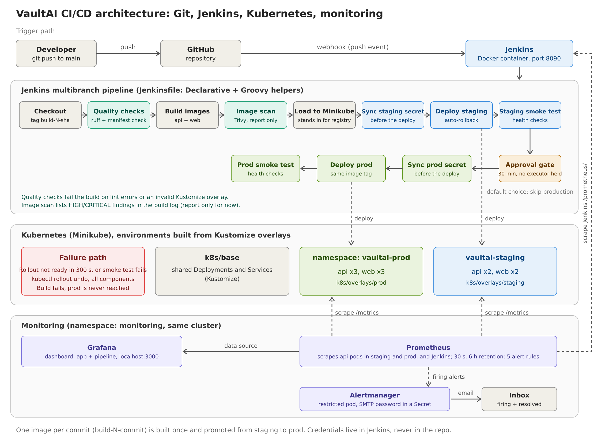

The same flow as a diagram that GitHub renders from text:

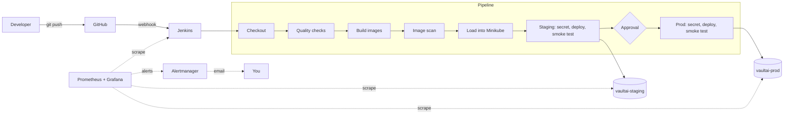

Staging and prod are not separate branches. There is one `main` branch, and the differences between environments (namespace, replica count, resource limits) live in Kustomize overlays. I went this way so that what gets tested in staging is exactly what gets shipped, and so adding an environment means adding a folder instead of copying the pipeline.

## What's in the repo

```
Jenkinsfile              the pipeline (Declarative, with Groovy helper functions)
api/Dockerfile           API image (Python)
app/Dockerfile           web image (Node build, served by nginx)
nginx/default.conf       nginx config, including the API proxy
k8s/base/                shared Deployments and Services
k8s/rbac/                namespace-scoped RBAC for the Jenkins deployer (staging, prod)
docs/screenshots/        evidence screenshots used in this README
k8s/overlays/staging/    namespace vaultai-staging, 2 replicas
k8s/overlays/prod/       namespace vaultai-prod, 3 replicas, higher API limits
jenkins/Dockerfile       Jenkins image with the docker CLI and kubectl added
jenkins/install-ci-tools.sh  puts ruff and the Trivy database into the running Jenkins container
monitoring/              in-cluster Prometheus + Grafana, port-forward services, memory fix
ruff.toml                lint rules for the Quality Checks stage
```

## What you need

- Docker, kubectl and a running Minikube cluster
- A GitHub repo with this code, plus a personal access token that can read it
- Node.js and npm on the host, only for the webhook forwarder

## Setup

### 1. Kubernetes

```bash
kubectl create namespace vaultai-staging
kubectl create namespace vaultai-prod

# check that both overlays render before applying anything
kubectl kustomize k8s/overlays/staging
kubectl kustomize k8s/overlays/prod
```

### 2. Jenkins

The pipeline needs `docker` and `kubectl` inside the Jenkins container, which the stock image doesn't have. `jenkins/Dockerfile` adds them.

```bash
docker build -t jenkins-custom:latest jenkins/

docker run -d --name jenkins --restart unless-stopped --network minikube \
  -p 8090:8080 \
  -v jenkins_home:/var/jenkins_home \
  -v /var/run/docker.sock:/var/run/docker.sock \
  -v $HOME/.minikube:$HOME/.minikube \
  -v $HOME/.kube:/root/.kube \
  -e MINIKUBE_HOME=$HOME/.minikube \
  -e JAVA_OPTS="-Xmx512m -Xms256m -Dhudson.plugins.git.GitStatus.NOTIFY_COMMIT_ACCESS_CONTROL=disabled-for-polling" \
  jenkins-custom:latest
```

Plugins I used: Git, Pipeline, Multibranch Pipeline, Credentials Binding, Timestamper, Workspace Cleanup, and Blue Ocean for the nicer stage view.

The `JAVA_OPTS` flag is explained in the webhook section below.

### 2a. Tools for the quality stages

The Quality Checks and Image Scan stages need `ruff` and `trivy` inside the Jenkins container. Install Trivy once (the installer script from the Trivy project; in a Dockerfile I would pin the release and verify its checksum instead), then let the script add ruff and the vulnerability database:

```
docker exec -u root jenkins sh -c "curl -sfL https://raw.githubusercontent.com/aquasecurity/trivy/main/contrib/install.sh | sh -s -- -b /usr/local/bin v0.71.2"
trivy image --download-db-only          # on the host, once (about 130 MB, retry if it times out)
bash jenkins/install-ci-tools.sh        # ruff binary (checksum-verified) + copies the Trivy database into Jenkins
```

The Trivy database is a snapshot, so it gets stale; rerun the last two commands to refresh it. These tools are installed into the running container rather than baked into `jenkins/Dockerfile`, which I would change before relying on this beyond a demo.

### 3. Credentials

Add these under Manage Jenkins, Credentials:

| ID | Type | Used for |
|---|---|---|
| `github-token` | Username and password (PAT) | reading the repo |
| `kubeconfig-staging` | Secret file | kubectl access to `vaultai-staging` only, via a namespace-scoped ServiceAccount (RBAC Role limited to deployments/services/secrets/pods-exec in that namespace) |
| `kubeconfig-prod` | Secret file | kubectl access to `vaultai-prod` only, same RBAC scoping, completely separate token from staging |
| `vaultai-anthropic-key` | Secret text | the app's API key, which the pipeline puts into a Kubernetes Secret |

`minikube-kubeconfig` (cluster-admin) is kept only for one-time manual setup (namespaces, the RBAC objects themselves). The pipeline itself never uses it.

None of these are in the repo or in the build logs. Jenkins masks them when they are used.

### 4. The Jenkins job

Create a Multibranch Pipeline job, point it at the GitHub repo with the `github-token` credential, and leave the script path as `Jenkinsfile`. Every branch gets built, but only `main` deploys. That branch name is set in `appConfig()` at the top of the Jenkinsfile.

### 5. Triggering builds on push

Jenkins runs on localhost, so GitHub can't call it directly. I used [smee.io](https://smee.io), which is a common way to get around this in local development.

1. Create a channel on smee.io, then add a webhook in the GitHub repo settings. Use the smee URL as the payload URL, `application/json` as the content type, and send only push events.
2. Run the forwarder as a systemd service so it keeps going after the terminal is closed:

```bash
sudo tee /etc/systemd/system/smee-jenkins.service > /dev/null << 'EOF'
[Unit]
Description=smee.io webhook forwarder for Jenkins
After=network.target docker.service

[Service]
Type=simple
ExecStart=/usr/bin/npx --yes smee-client --url https://smee.io/<your-channel> --target http://localhost:8090/git/notifyCommit?url=https://github.com/kernal05/Finacplus-Vaultai
Restart=always
RestartSec=5
User=vishal

[Install]
WantedBy=multi-user.target
EOF

sudo systemctl daemon-reload
sudo systemctl enable --now smee-jenkins
```

3. By default the Git plugin answers `401 An access token is required` to calls like this. The Jenkins version I used didn't show a place to create a notifyCommit token, so I set `NOTIFY_COMMIT_ACCESS_CONTROL=disabled-for-polling` in `JAVA_OPTS` instead. All that does is let the endpoint ask Jenkins to rescan the repo. It can't run anything else.

If the webhook path is down (for example the laptop was asleep), use Scan Repository Now in Jenkins to pick up the missed push.

On a real server with a public address, GitHub would call Jenkins directly and none of the smee setup would be needed.

## What the pipeline does

1. **Checkout.** Gets the commit and builds an image tag like `build-16-1f682e4` (build number plus short commit), so any running pod can be traced back to a commit.
2. **Quality checks.** Runs `ruff check` on the API code and renders both Kustomize overlays, so a lint error or a broken manifest fails the build before any image is built.
3. **Build images.** Builds the API and web images.
4. **Image scan.** Trivy lists the HIGH and CRITICAL vulnerabilities that have a fix available, for each image. It is report-only at the moment; setting `SCAN_ENFORCE_CRITICAL = 'true'` in the Jenkinsfile makes fixable CRITICAL findings fail the build.
5. **Load images into Minikube.** Copies the images into the cluster node. This stands in for pushing to a registry and takes about three minutes, which is the slowest part of the pipeline.
6. **Sync staging secret.** Creates or updates the Kubernetes Secret before the deploy, so new pods start with the current value.
7. **Deploy staging.** Applies the staging overlay with this build's image tags pinned into it, and waits for the rollout. If the rollout doesn't finish in 300 seconds (the whole step is capped at 330), it runs `kubectl rollout undo` on every component and fails the build.
8. **Staging smoke test.** Runs the health endpoints from inside the API and web pods.
9. **Approve production.** Waits up to 30 minutes for a person to choose. The default option is "Skip production (staging only)". This step doesn't hold a Jenkins executor while it waits.
10. **Production stages.** Same secret, deploy and smoke test steps against the prod overlay, using the image that was already tested in staging.

If a new push arrives while a build is sitting at the approval step, the old build is aborted and replaced (`abortPrevious`). Without that, a forgotten approval would block every later build.

## Using it for other repos or clusters

The repo-specific parts are in two functions at the top of the Jenkinsfile.

`appConfig()` lists the components to build and deploy: deployment name, container, image name, Dockerfile, build context and smoke test command. It also holds the secret name and which branch deploys. To onboard another service, add another entry to the list.

`envConfig()` lists the environments: namespace, overlay folder, and the Jenkins credential IDs for the kubeconfig and the API key. To add an environment or point at a different cluster, add an entry, create a credential, and add a `k8s/overlays/<name>` folder.

If this were used across many repos, I would move the helper functions into a Jenkins Shared Library and keep only these two config functions in each repo's Jenkinsfile. I haven't done that here.

## Quality checks and image scanning

Two stages run on every branch, before anything is deployed:

| Stage | What it does | Fails the build when |
|---|---|---|
| Quality Checks | `ruff check api/` (rules in `ruff.toml`), and `kubectl kustomize` for the staging and prod overlays | the code has lint errors or an overlay no longer renders |
| Image Scan | Trivy scans both images for vulnerabilities that have a fix available | never today (report only); with `SCAN_ENFORCE_CRITICAL = 'true'`, when a fixable CRITICAL finding exists |

Dependencies in `api/requirements.txt` are pinned to exact versions, so two builds of the same commit install the same packages.

**Known issues.**
- Trivy reports HIGH and CRITICAL findings in the OS packages of the base images (Debian for the API, Alpine for the web image). The fix is a newer base image. The web image runs `apk upgrade` to pick up fixed packages; the API image now does the same with apt-get upgrade, and both images scan clean. The findings for each build are in its console log.
- The scan is report-only because enforcing it on day one would block deploys on findings I haven't triaged. Turning it on is a one-line change.
- Trivy runs offline against a database copied into Jenkins (the download is slow on this connection), so it can be out of date.
- There is no automated test suite for the application itself. The checks above, the manifest rendering and the smoke tests after each deploy are what guard a release.

## Image scan results

Trivy scans both images after they are built. It lists only findings that already have a fix available, and it is report-only, so findings do not fail the build.

| Image | Before | After |
|---|---|---|
| vaultai-web | 2 critical OpenSSL findings (`libcrypto3`, `libssl3`) | 0, after `apk upgrade` was added to its Dockerfile |
| vaultai-api | 1 HIGH: `libpcre2-8-0` (CVE-2026-103111), fixed in 10.46-1~deb13u3 | 0, after `apt-get upgrade` was added to its Dockerfile |

All Python dependencies scan clean. Both images now scan clean, so `SCAN_ENFORCE_CRITICAL` can be switched to `'true'`.

## Security notes

What is already in place:

- No credentials in the code or the git history. `git grep "sk-ant"` and `git log -S"sk-ant"` both return nothing.
- Secrets reach the pipeline through Jenkins credentials and are masked in logs.
- Production needs a manual approval, and only the Jenkins users or groups listed in `PROD_APPROVERS` in the Jenkinsfile can give it. Each environment uses its own namespace-scoped kubeconfig credential.
- Only `main` deploys. Other branches stop after building images.
- The API container runs as a non-root user. All containers have resource limits and liveness and readiness probes.

Shortcuts I took because this runs locally, and what I'd do instead:

| Shortcut | What I'd do in a real setup |
|---|---|
| Webhook endpoint is open to unauthenticated calls (rescan only) | Public HTTPS Jenkins with a notifyCommit token or a signed GitHub webhook |
| Images are loaded straight into Minikube | Push to a private registry with fixed tags, and make the Trivy scan block the build on fixable CRITICAL findings (it is report-only here) |
| Docker socket is mounted into Jenkins | Throwaway build agents such as Kubernetes agents or Kaniko |

## How I tested it

- **Manifests:** `kubectl kustomize k8s/overlays/staging` and `.../prod` show the right namespace, replica count and limits.
- **Webhook:** pushed a commit and watched `journalctl -u smee-jenkins -f`. It showed `POST ... - 200` and a build started right away.
- **Smoke tests:** the API returns `{"status":"ok","service":"vaultai-api"}` and the web pod returns `ok`, in both environments.
- **Full promotion:** staging, approval, then the same image tag in prod with 3 replicas each.
- **Rollback:** I changed the API readiness probe path from `/healthz` to `/nope` and pushed. The new pod never became ready, the rollout hit the timeout, the pipeline ran the rollback and failed with "rolled back automatically", and production was never reached. Old pods kept serving the whole time.
- **Recovery:** reverted the change, and the next build went through normally.
- **Push-triggered run:** a push started the build by itself through the webhook. It passed pip-audit and Trivy (0 findings), staging, approval and production.

To repeat the rollback test, break the probe path in `k8s/base/api-deployment.yaml`, push, and revert once the build has failed. Wait for the failed build to finish before pushing the revert, because a new push aborts a running build.

## Deployment reliability

- Rolling updates use `maxUnavailable: 0` and `maxSurge: 1`, with `progressDeadlineSeconds: 300`, so capacity never drops during a release.
- Each container has startup, readiness and liveness probes with 5 second timeouts.
- The pipeline waits up to 300 seconds for each rollout and runs `kubectl rollout undo` automatically if it fails. Staging runs 2 replicas per service and prod runs 3.
- Quality gates: `ruff`, a non-blocking `pip-audit` (120 second cap), manifest validation with `kubectl kustomize`, and a Trivy image scan.

## Monitoring and logging

Prometheus and Grafana run **inside the cluster**, in their own `monitoring` namespace. The full
`kube-prometheus-stack` Helm chart did not fit on this machine (Windows has 7 GB of RAM, WSL gets
4.8 GB, Minikube started with 2.1 GB), so I run two plain Deployments instead. Together they are
limited to about 580 MiB.

| What | How |
|------|-----|
| Prometheus | Scrapes every `vaultai-api` pod in `vaultai-staging` and `vaultai-prod` (found through the Kubernetes API, so new replicas are picked up automatically) and Jenkins (`/prometheus/`, from the Prometheus Metrics plugin). 30s interval, 6h retention. |
| Grafana | One provisioned dashboard, "VaultAI - App and CI/CD pipeline": scrape targets up/down, Jenkins up, builds recorded, average build duration, API requests per second by status, API p95 latency, API 5xx ratio. |
| Alert rules | `VaultAIAPIDown`, `VaultAIHighErrorRate` (>5% 5xx), `VaultAIHighLatency` (p95 > 3s), `JenkinsDown` and `VaultAIAPIMissing` (no prod API pods). Alerts are emailed through Alertmanager. |
| Install | `bash monitoring/monitoring-lite.sh` (idempotent; `--remove` deletes everything). |
| Access | Nothing is exposed outside the cluster. `monitoring/monitoring-portforward-service.sh` keeps `localhost:3000` (Grafana) and `localhost:9090` (Prometheus) available as systemd services. |

**Security of the monitoring stack.** The namespace enforces the Pod Security `restricted` profile.
Containers run as non-root with all capabilities dropped and a read-only root filesystem (Prometheus).
Prometheus's service account can only read pod metadata. The Grafana admin password is random and
stored in a Kubernetes Secret.

**What I checked.** All Prometheus targets were UP (Jenkins, Prometheus itself, and the staging and prod API pods), and the Grafana dashboard loaded data from them.

**Limits, stated plainly.**
- Alerts go out by email only. There is no Slack or paging receiver. Delivery was verified with a live drill (prod API scaled to zero, firing and resolved emails received).
- Metrics and dashboards live in temporary (emptyDir) volumes with 6 hours of retention, so history is lost when a pod restarts. The dashboard itself is provisioned from a ConfigMap and comes back.
- No kube-state-metrics or node metrics, so there are no pod-restart or CPU/memory panels.
- Logs are not collected centrally. `kubectl logs deploy/<name> -n <namespace>` is the current answer.

**What I would add next.**
- A Slack receiver next to the email one, and a build-failure alert from Jenkins metrics.
- kube-state-metrics for unavailable replicas, crash loops and failed rollouts.
- Loki (or EFK) for container logs.
- A registry push instead of the Minikube image load, which would remove about 2 to 3 minutes per build.
- The approval step already records who approved a release in the build log.

## Alerting (Alertmanager, email)

Prometheus evaluates the alert rules and sends firing alerts to Alertmanager, which emails them (and the resolved notice) through Gmail SMTP.

- Alertmanager runs in the `monitoring` namespace under the `restricted` Pod Security profile: non-root, read-only root filesystem, all capabilities dropped, seccomp `RuntimeDefault`, with CPU and memory limits.
- The SMTP app password is stored only in the Kubernetes Secret `alertmanager-smtp` and mounted as a read-only file. It is never in the repository or in a ConfigMap. `monitoring/monitoring-lite.sh` asks for it with hidden input the first time.
- Alert rules: `VaultAIAPIDown`, `VaultAIHighErrorRate`, `VaultAIHighLatency`, `JenkinsDown`, and `VaultAIAPIMissing`. The last one fires when no API pods exist in `vaultai-prod`, which catches the case where the API is scaled to zero.
- Verification: the prod API was scaled to 0 and `VaultAIAPIMissing` fired after about 90 seconds. The `[FIRING:1]` email arrived, prod was restored to 3 replicas, and a `[RESOLVED]` email followed. Alertmanager's `alertmanager_notifications_failed_total` stayed at 0.


## Problems I hit and how I fixed them

The pipeline was not right the first time. These are the real issues, in the order they mattered.

| Problem | How I found it | Fix |
|---|---|---|
| A build hung for over 30 minutes, another failed | Pods restarted, `kubectl get events` showed probe timeouts, and `docker stats` showed Minikube at 80 to 90 percent of its 2.1 GB cap | Raised the container's memory cap to 3 GB (`monitoring/stabilize.sh`) and set probe `timeoutSeconds: 5` instead of 1. The deploy step now has a hard timeout, so a stall fails and rolls back instead of hanging |
| Rebuilding the API image took about 14 minutes | The Python dependency layer was reinstalled on every build over a slow connection | A BuildKit cache mount on the pip layer, and pinned dependencies so the layer only changes when they do |
| Webhook returned `401 An access token is required` | smee.io relay log and the Jenkins response | `NOTIFY_COMMIT_ACCESS_CONTROL=disabled-for-polling`, which only lets the endpoint trigger a rescan. A real server would use a token or a signed webhook |
| `ErrImagePull` in the cluster | `kubectl describe pod` | Minikube has its own Docker daemon, so images must be loaded into it. Added the load stage to the pipeline |
| The full `kube-prometheus-stack` did not fit | The chart's pods needed more memory than the node had | Replaced it with two small Deployments (Prometheus and Grafana) with explicit limits, then added Alertmanager |
| `kubectl port-forward` blocked terminals and died | Foreground processes | Ran them as systemd services that restart themselves |
| The "API down" alert would not fire when the API was scaled to zero | The `up` metric disappears when there are no pods, so the expression never matches | Added `VaultAIAPIMissing`, which fires when no prod API pods exist, and proved it with a live drill |
| Image scan needed a 130 MB database and the download was slow | Trivy retried and timed out | Download once on the host, copy the database into Jenkins and scan offline |

## How I worked: AI-assisted, human-verified

I used an AI assistant (Claude) throughout this project, the way I would use a senior colleague or the documentation: to move faster on work that follows well-known patterns, not to replace understanding. The AI knows the common patterns. I know this system: what it runs on, what broke, and why each choice was made.

**Where AI helped**
- First drafts of boilerplate: the Jenkinsfile helper functions, Kustomize overlays, RBAC manifests, shell scripts, the README structure and the diagram.
- Recalling syntax and flags quickly (kubectl, Trivy, Prometheus relabeling, Alertmanager configuration).
- A second pair of eyes: reviewing my work for gaps, such as missing quality gates, and for README numbers that did not match the manifests.

**What I did myself**
- **Design decisions.** One image built once and promoted, Kustomize overlays instead of a branch per environment, separate scoped credentials for staging and prod, an approval gate, and a report-only scan to start with.
- **Ran and read everything.** Every command ran on my own machine, and I read the output. When something failed I worked from evidence (`docker stats`, `kubectl get events`, Jenkins console logs). That is how the memory starvation, the probe timeouts and the webhook 401 were found and fixed.
- **Trade-offs.** I dropped the full `kube-prometheus-stack` because it did not fit my machine, kept the image scan report-only until the findings were clean, and chose a documented plan over an untested cloud setup.
- **Verified instead of trusting.** I broke a probe path on purpose to prove the rollback, scaled prod to zero to prove the alert email, and checked the documentation against the repository.
- **Corrected the AI where it was wrong for my setup.** For example a command flag that did not exist, a tool that was missing on my machine, and README claims that disagreed with the real replica counts and timeouts.

I can explain any part of this repository and why it is built that way. The AI made me faster. It did not make the decisions.

## Known limitations

Stated up front so nobody has to find them:

- **Local only.** Everything ran on one Minikube node. Images are loaded into the node instead of pushed to a registry, so they are not scanned or signed in a registry and cannot be pulled by another cluster.
- **Cloud steps are a plan, not a result.** I did not have a GCP or AWS account to run it on, so [Deploying to AWS or GCP](#deploying-to-aws-or-gcp-instead-of-minikube) is untested. Terraform is not used. Namespaces and RBAC are plain manifests.
- **The Anthropic API key is shared.** Staging and prod have separate cluster credentials, but both read the same `vaultai-anthropic-key` Jenkins credential. Splitting it is a one-line change in `envConfig()` plus a second credential.
- **Docker socket and admin kubeconfig.** Jenkins mounts the Docker socket, which is effectively root on the host. The `docker run` command also mounts the admin kubeconfig for one-time setup. The pipeline itself uses only the scoped credentials, but I would remove that mount after setup.
- **No automated test suite for the application.** Quality is guarded by lint, manifest rendering, the image scan and smoke tests after each deploy.
- **Image scan is report-only** (`SCAN_ENFORCE_CRITICAL = 'false'`). Both images scan clean now, so it can be switched on.
- **Metrics history is temporary.** Prometheus and Grafana use emptyDir volumes with 6 hours of retention. Logs are not collected centrally.
- **Alerts are email only.** No Slack or paging receiver.
- **A new push aborts a build waiting for approval** (`abortPrevious`). That is deliberate, but it also stops a deploy that is running when the push arrives.

## Troubleshooting

- **Webhook returns 401.** The Git plugin wants a notifyCommit token. Either create one or use the `JAVA_OPTS` flag from step 2.
- **"No git jobs using repository" in the webhook response.** Normal for a multibranch job. It still schedules a branch scan.
- **Rollout times out.** Look at `kubectl describe pod` and check the probe paths. The pipeline will already have rolled back.
- **`ErrImagePull` in a pod.** The image wasn't loaded into Minikube. Check the "Load Images into Minikube" stage.
- **A running build disappears after a new push.** That's the `abortPrevious` setting doing its job.
- **Rollouts or health checks time out on a small machine.** This happened here: Minikube was capped at
  2.1 GB and ran at 80 to 90 percent of it, probes timed out after 1 second, pods restarted and a rollout
  hung for 30 minutes. Fixes: raise the container's memory cap (`monitoring/stabilize.sh` sets 3 GB without
  recreating the cluster; the cap resets when Minikube or WSL restarts, so run it again after a restart),
  and use probe timeouts of 5 seconds instead of the default 1 second. The deploy stage also wraps
  `kubectl rollout status` in `timeout 330` so a stalled machine fails the build (and rolls back) in
  minutes instead of hanging it.

## Deploying to AWS or GCP instead of Minikube

The pipeline runs on Minikube today. The steps below are the plan for running it on AWS or GCP.

The pipeline is written so that moving to a managed cluster changes the credentials and the image step, not the pipeline logic. Everything else (Kustomize overlays, rollout checks, smoke tests, approval gate, rollback) stays the same.

### What changes

| Local (Minikube) | AWS | GCP |
|---|---|---|
| Images loaded with `docker save` and `docker load` | Push to Amazon ECR | Push to Artifact Registry |
| Cluster is Minikube | Amazon EKS | Google GKE |
| Jenkins credential is a namespace-scoped kubeconfig | Same, with the token of a namespace-scoped ServiceAccount | Same |
| Secret `vaultai-secrets` created by the pipeline | Optionally sync from AWS Secrets Manager | Optionally sync from Secret Manager |
| Webhook forwarded through smee.io | GitHub calls Jenkins directly (public HTTPS URL) | Same |
| Services reached with port-forward | LoadBalancer or Ingress (ALB controller) | LoadBalancer or Ingress (GCE) |

### Steps

1. **Create the registry and push images.** Replace the "Load Images into Minikube" stage with a push stage.

   AWS:
```bash
   aws ecr create-repository --repository-name vaultai-api
   aws ecr create-repository --repository-name vaultai-web
   aws ecr get-login-password --region <region> | docker login --username AWS --password-stdin <account>.dkr.ecr.<region>.amazonaws.com
   docker tag vaultai-api:$TAG <account>.dkr.ecr.<region>.amazonaws.com/vaultai-api:$TAG
   docker push <account>.dkr.ecr.<region>.amazonaws.com/vaultai-api:$TAG
```

   GCP:
```bash
   gcloud artifacts repositories create vaultai --repository-format=docker --location=<region>
   gcloud auth configure-docker <region>-docker.pkg.dev
   docker tag vaultai-api:$TAG <region>-docker.pkg.dev/<project>/vaultai/vaultai-api:$TAG
   docker push <region>-docker.pkg.dev/<project>/vaultai/vaultai-api:$TAG
```

2. **Point the image pins at the registry.** The pipeline already generates `image-pins.yaml` per build. Use the full registry path in it, and set `imagePullPolicy: IfNotPresent` or `Always`. Give the cluster permission to pull (EKS node role with ECR read access, or GKE node service account with Artifact Registry Reader).

3. **Create the cluster and a restricted deployer identity.**

   AWS:
```bash
   eksctl create cluster --name vaultai --region <region> --nodes 2
   aws eks update-kubeconfig --name vaultai --region <region>
```

   GCP:
```bash
   gcloud container clusters create vaultai --region <region> --num-nodes 2
   gcloud container clusters get-credentials vaultai --region <region>
```

   Then apply `k8s/rbac/rbac-staging.yaml` and `k8s/rbac/rbac-prod.yaml` (the namespace-scoped Roles used here) and build one kubeconfig per environment from the `jenkins-deployer` ServiceAccount token. Store each in Jenkins as a Secret File credential. Do not give Jenkins cluster-admin.

4. **Use separate clusters or namespaces per environment.** For a stronger split, create one cluster for staging and one for prod, then store a different kubeconfig credential for each. `deployEnv()` only needs a namespace and a credential ID, so no pipeline logic changes.

5. **Run Jenkins where GitHub can reach it.** Put it on a VM or in the cluster behind HTTPS. Remove smee.io and add a normal GitHub webhook pointing at `https://<jenkins-host>/github-webhook/` (or the `notifyCommit` URL with an access token). Re-enable the Git plugin's access control.

6. **Secrets.** Keep secret values in Jenkins credentials or the cloud secret manager. Never put them in the repository or in ConfigMaps.

7. **Monitoring.** Run Prometheus and Alertmanager in the cluster, or use Amazon Managed Prometheus or Google Managed Service for Prometheus. The alert rules and Grafana dashboard carry over unchanged.

### Adding another repository or cluster

- **New repository:** add it as another multibranch pipeline or GitHub organization folder in Jenkins. Each repository brings its own `Jenkinsfile` and `k8s/` overlays.
- **New cluster or environment:** add an overlay under `k8s/overlays/<name>/`, a namespace-scoped RBAC manifest, and a Jenkins kubeconfig credential, then add one entry to the environments list in the `Jenkinsfile`.

## Evidence

| What it shows | Screenshot |
|---|---|
| Green pipeline: staging, manual approval, production | 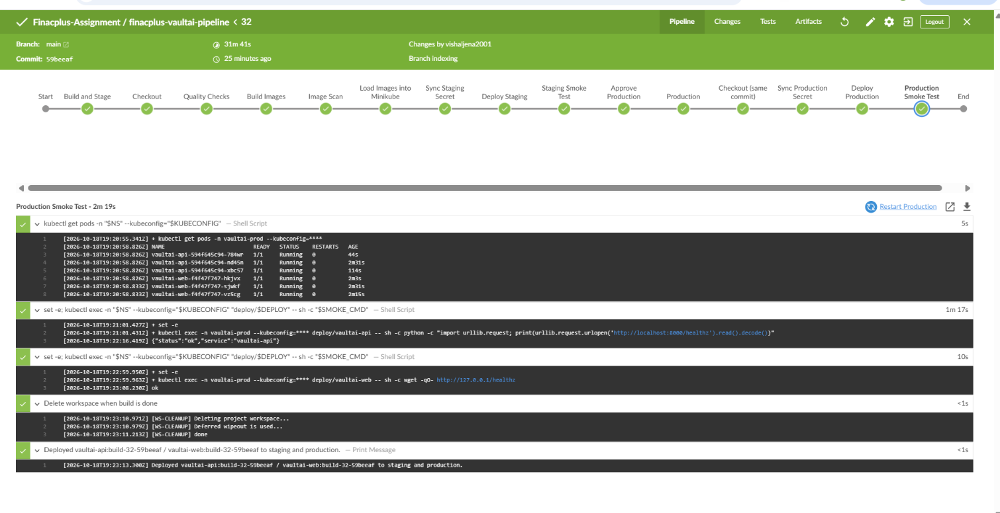 |
| Push-triggered build via the smee.io webhook | 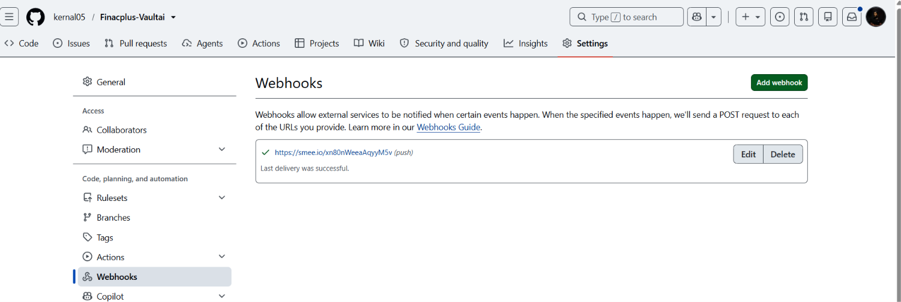 |
| Trivy image scan with 0 fixable HIGH or CRITICAL findings | 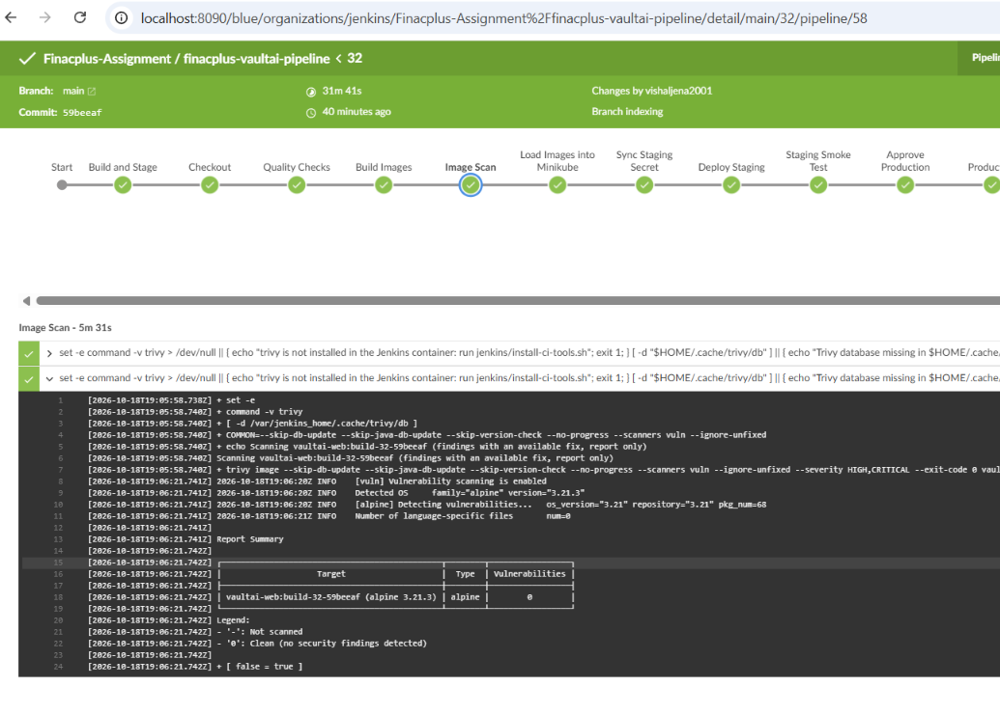 |
| Pods running in staging, prod and monitoring | 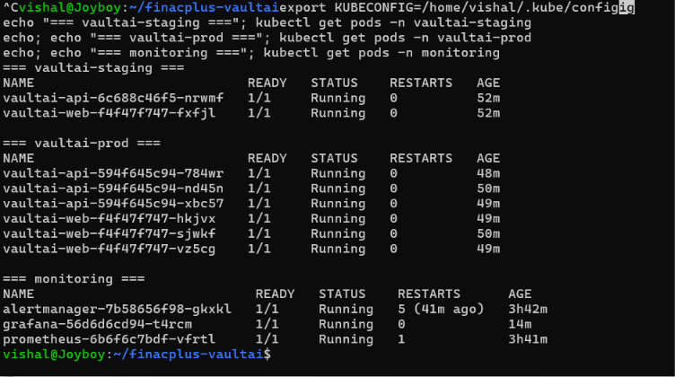 |
| Grafana dashboard | 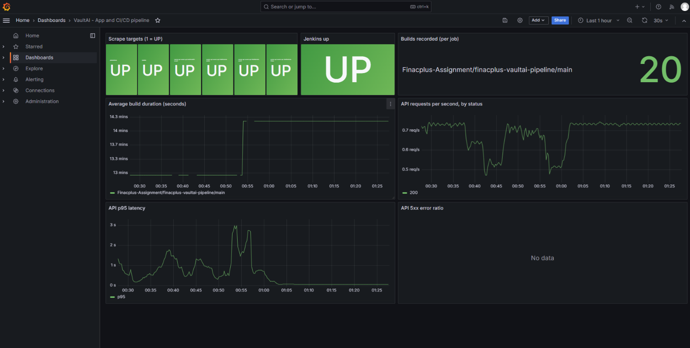 |
| Alert firing email (prod API scaled to 0) | 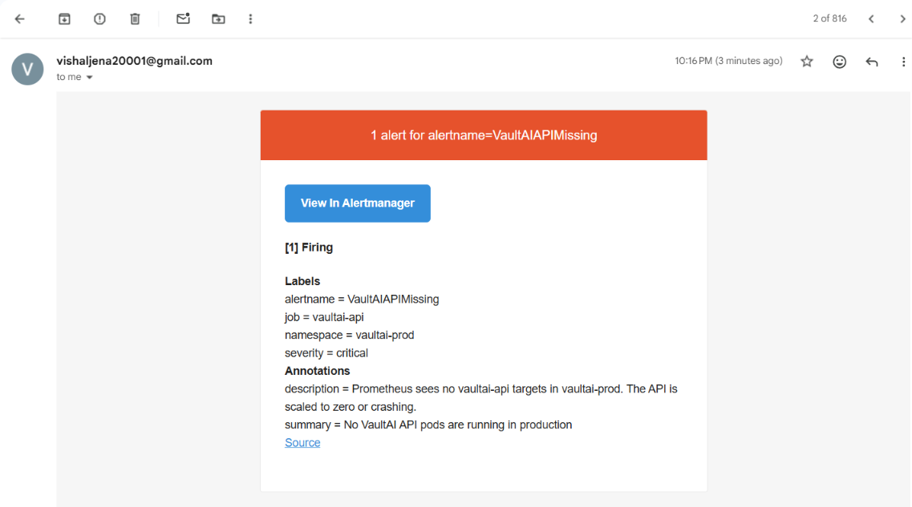 |
| Alert resolved email | 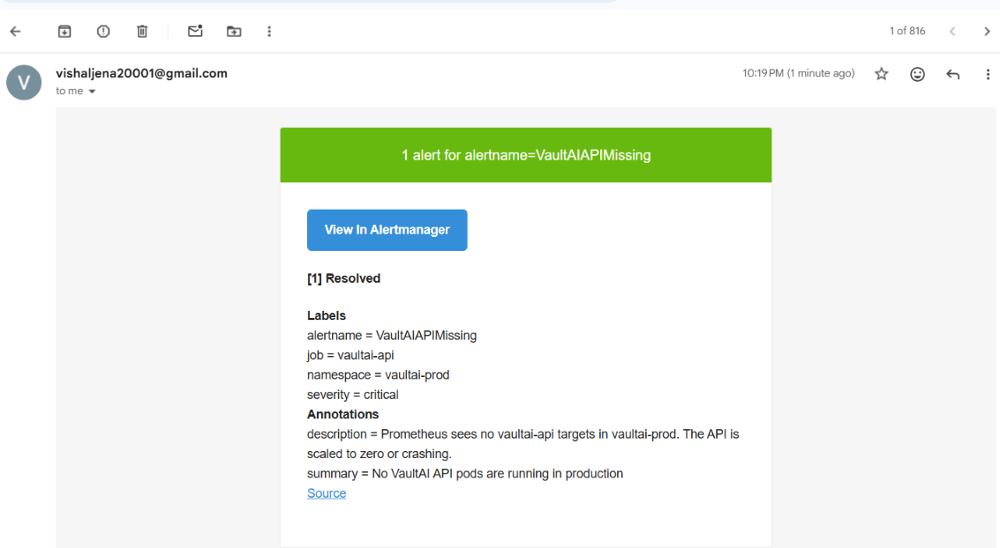 |
| Prometheus targets | 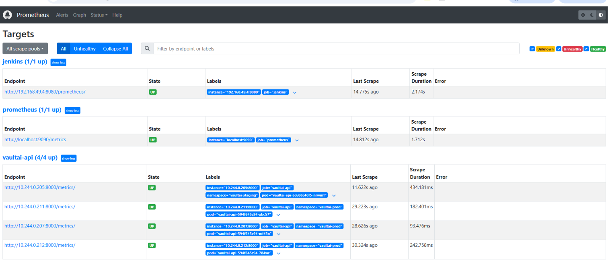 |
| The VaultAI application (home page) |  |

Note: on this 4.8 GB laptop a full run takes roughly 14 to 17 minutes once Docker layers are cached. A first build, or a run after Minikube hit its memory limit, can take much longer. The slowest remaining step is loading images into Minikube (about three minutes). A registry removes it, and should bring a run to roughly 10 to 14 minutes (estimate, not measured).
